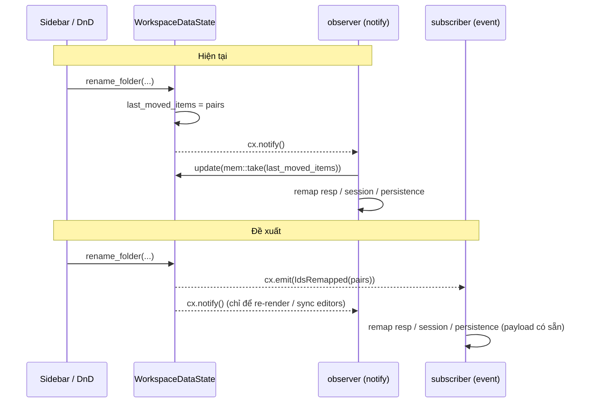

# Thay các trường `last_*` của WorkspaceDataState bằng GPUI typed events

## Goal

`WorkspaceDataState` hiện dùng 4 trường để báo cho bên ngoài biết "vừa có gì thay đổi":

| Trường | Ghi tại | Đọc / xoá tại |
|---|---|---|
| `last_renamed_request: Option<(String, String)>` | `rename_request_internal` | observer #5, `read().clone()`, **không bao giờ xoá** |
| `last_renamed_example: Option<(String, String, String)>` | `rename_example_internal` | observer #5, `take()` |
| `last_moved_items: Vec<(String, String)>` | `rename_folder_internal`, `move_folder_internal`, `move_request_across_folders` | observer #5, `mem::take` |
| `last_crud_error: Option<String>` | `move_folder_internal` | observer #5, `take()` |

Luồng hiện tại là **"đặt cờ → notify → observer đọc lại và tự xoá"**. Pattern này tạo ra một kênh gửi tin ngầm qua state dùng chung. Plan thay nó bằng **GPUI typed events** (`EventEmitter<WorkspaceEvent>` + `cx.emit` + `cx.subscribe_in`): payload đi kèm luôn trong một lần phát, bên nhận khỏi phải đọc lại state, và `WorkspaceDataState` chỉ còn giữ domain data.



## Lỗi đang có mà thay đổi này sửa luôn

> [!WARNING]
> 1. **`last_renamed_request` không bao giờ được xoá.** Sau lần rename đầu tiên, *mọi* `notify` của workspace (mỗi lần gõ phím vào URL, toggle pin…) lại chạy `resp.rename_request(old, new)` thêm một lần. Ví dụ: rename `new-request.yaml → login.yaml`, sau đó tạo request mới (id lại là `new-request.yaml`), thì response cache của request mới sẽ bị chuyển nhầm sang `login.yaml`.
> 2. **Toast lỗi bị trễ.** Khi `move_folder_internal` lỗi, nó trả về `false`, nên `move_folder` không gọi `cx.notify()`. Toast "Cannot move a folder into itself" chỉ hiện ra ở lần notify kế tiếp, do một thao tác khác hẳn gây ra.
> 3. **Rename request không remap dirty map của persistence.** Move có gọi `per.remap_request_ids`, còn rename thì không. Khi gộp chung vào một event `IdsRemapped`, cả hai luồng sẽ xử lý giống nhau.

## User Review Required

> [!IMPORTANT]
> **Đổi kiểu trả về của các hàm `*_internal`.** Vì `*_internal` không có `Context` (để test thuần không cần GPUI), payload sẽ đi ra qua **giá trị trả về**. Wrapper có `cx` sẽ dựng event và `emit`. 22 assert trong `workspace_collision_tests.rs` / `workspace_data_tests.rs` sẽ đổi từ kiểu `ws.last_moved_items == …` sang kiểm tra giá trị trả về.

> [!NOTE]
> **Giữ nguyên `tree_version` / `url_version`.** Hai trường này không phải "tin nhắn" mà là bộ đếm để invalidate cache khi render (sidebar memo). Bên đọc cần *trạng thái hiện tại*, không cần từng sự kiện, nên dùng observer + counter là đúng chỗ.

### Các phương án đã cân nhắc

| Phương án | Ưu | Nhược | Kết luận |
|---|---|---|---|
| **A. GPUI `EventEmitter` + `subscribe_in`** | Có sẵn trong framework, có kiểu, phát đồng bộ trong vòng effect, tự huỷ khi drop `Subscription`, codebase đã dùng (`InputEvent`) | Không có | ✅ Chọn |
| B. Command bus / `mpsc` channel | Tách được hẳn khỏi GPUI | Phải tự lo vòng đời, phải poll hoặc spawn task, chạy lệch với effect cycle nên dễ race với `notify` | ❌ Quá phức tạp |
| C. Queue `pending_events: Vec<_>` + observer drain | Thay đổi ít | Bản chất vẫn là `last_*` dưới dạng danh sách, chưa sửa được gốc vấn đề | ❌ |

## Proposed Changes

---

### State layer

#### [NEW] `crates/app/src/state/workspace_events.rs`

```rust
//! Typed events emitted by `WorkspaceDataState` so downstream states receive
//! change payloads in a single dispatch instead of polling `last_*` fields.

use super::WorkspaceDataState;
use gpui::EventEmitter;

#[derive(Debug, Clone, PartialEq, Eq)]
pub enum WorkspaceEvent {
    /// Request/folder ids changed on disk (request rename, folder rename/move,
    /// cross-folder request move). `(old_id, new_id)` pairs.
    IdsRemapped(Vec<(String, String)>),
    /// A saved example of `req_id` was renamed.
    ExampleRenamed { req_id: String, old_name: String, new_name: String },
    /// A user-initiated CRUD operation was rejected; surfaced as an error toast.
    CrudFailed { title: &'static str, message: String },
}

impl EventEmitter<WorkspaceEvent> for WorkspaceDataState {}

/// Outcome of a folder move, returned by `move_folder_internal`.
#[derive(Debug, Clone, PartialEq, Eq)]
pub enum FolderMoveOutcome {
    /// Nothing changed (unknown source, same-parent drop with no target).
    Unchanged,
    /// Same-parent drop: in-memory sibling reorder only.
    Reordered,
    /// Moved on disk; `(old_id, new_id)` pairs of the folder and descendants.
    Moved(Vec<(String, String)>),
}
```

#### [MODIFY] `state/mod.rs`
Thêm `mod workspace_events; pub use workspace_events::{WorkspaceEvent, FolderMoveOutcome};`.

#### [MODIFY] `workspace_data_state.rs`
Bỏ 4 trường `last_renamed_request`, `last_renamed_example`, `last_moved_items`, `last_crud_error` khỏi struct và khỏi cả hai constructor `new()` / `new_for_path()`.

#### [MODIFY] `workspace_crud.rs`

Hàm `*_internal` trả payload ra ngoài; wrapper thì **`emit` trước, `notify` sau**. GPUI xử lý `pending_effects` theo FIFO, nên subscriber cập nhật session pointer xong rồi observer mới chạy `sync_active_request_editors`, nhờ vậy editor sync đúng theo id mới.

| Hàm | Kiểu trả về cũ → mới | Event do wrapper phát |
|---|---|---|
| `rename_request_internal` | `Option<String>` (giữ nguyên) | `IdsRemapped([(old, new)])` nếu `old != new` |
| `rename_folder_internal` | `Option<String>` → `Option<Vec<(String,String)>>` | `IdsRemapped(pairs)` |
| `move_folder_internal` | `bool` → `Result<FolderMoveOutcome, String>` | `Moved` → `IdsRemapped`; `Err` → `CrudFailed` (**có notify**, sửa lỗi #2) |
| `move_request_across_folders` / `move_request_to_folder_internal` | `Option<String>` (giữ nguyên) | `IdsRemapped([(src, new)])` |
| `move_request` (cross-folder) | không đổi | `IdsRemapped` nếu nhánh cross-folder thành công |
| `rename_example_internal` | `bool` → `Option<String>` (tên unique cuối cùng) | `ExampleRenamed{..}` |

Ví dụ:

```rust
pub fn move_folder(&mut self, src: &str, target: Option<String>, cx: &mut Context<Self>) {
    match self.move_folder_internal(src, target) {
        Ok(FolderMoveOutcome::Unchanged) => {}
        Ok(FolderMoveOutcome::Reordered) => cx.notify(),
        Ok(FolderMoveOutcome::Moved(pairs)) => {
            cx.emit(WorkspaceEvent::IdsRemapped(pairs));
            cx.notify();
        }
        Err(message) => cx.emit(WorkspaceEvent::CrudFailed {
            title: "Cannot rename or move",
            message,
        }),
    }
}
```

---

### App layer

#### [NEW] `crates/app/src/app/workspace_event_handler.rs`
Hàm `handle_workspace_event(this: &mut AppView, event: &WorkspaceEvent, cx)` chứa đúng logic đang nằm ở `subscriptions.rs` L470–525, chỉ khác là lấy payload từ `event`:

- `IdsRemapped(pairs)`: `resp.rename_request` cho từng cặp → cập nhật `session.active_request_id` nếu khớp → `per.remap_request_ids(pairs)`.
- `ExampleRenamed{old_name,new_name,..}`: `resp.rename_example`.
- `CrudFailed{title,message}`: `toast.push_error(title, message)`.

Tách ra file riêng để `subscriptions.rs` không phình thêm (giới hạn ~650 LOC).

#### [MODIFY] `app/subscriptions.rs`
- Xoá khối L470–525 trong observer #5. Observer này chỉ còn lo sync editors và phát hiện workspace path đổi.
- Thêm:
```rust
subscriptions.push(cx.subscribe_in(
    workspace_state,
    window,
    |this, _ws, event: &WorkspaceEvent, _window, cx| {
        workspace_event_handler::handle_workspace_event(this, event, cx);
    },
));
```

---

### Tests

#### [MODIFY] `workspace_collision_tests.rs`, `workspace_data_tests.rs`
- `assert!(ws.last_crud_error.is_none())` → kiểm tra kết quả `Ok(..)` / `Some(..)`.
- `assert_eq!(ws.last_moved_items, vec![..])` → so với `pairs` trả về từ hàm.
- `ws.last_crud_error.take().expect(..)` → `move_folder_internal(..).unwrap_err()`.
- `last_renamed_example` / `last_renamed_request` → so với giá trị trả về.

#### [NEW] test GPUI cho event (trong `workspace_events.rs`, `#[gpui::test]`)
Tạo entity, `cx.subscribe` vào một `Rc<RefCell<Vec<WorkspaceEvent>>>`, rồi kiểm tra:
- `rename_request` phát đúng **một** `IdsRemapped` với cặp đúng, và các lần `notify` sau đó **không** phát lại (chặn hồi quy lỗi #1).
- `move_folder` vào chính nó phát `CrudFailed` (chặn hồi quy lỗi #2).

#### [NEW] `docs/plans/20261026-workspace-event-emitter.md`
Bản sao của plan này, theo quy định trong AGENTS.md §4.

## Verification Plan

### Automated Tests
```bash
cargo fmt --check
cargo test
cargo clippy --all-targets -- -D warnings
grep -rn "last_renamed_request\|last_renamed_example\|last_moved_items\|last_crud_error" crates/  # phải rỗng
```

### Manual Verification
1. Rename một request đang mở: editor vẫn giữ nội dung, lịch sử response vẫn còn, tiêu đề cập nhật.
2. Rename/kéo thả folder chứa request đang mở: session vẫn trỏ đúng request, chấm dirty đi theo.
3. Kéo folder vào chính nó: toast lỗi hiện **ngay lập tức**.
4. Rename example đang xem: tên trong inspector cập nhật.
5. Rename request A thành B, tạo request mới, gửi request mới: response hiển thị đúng request mới, không lẫn với B.
