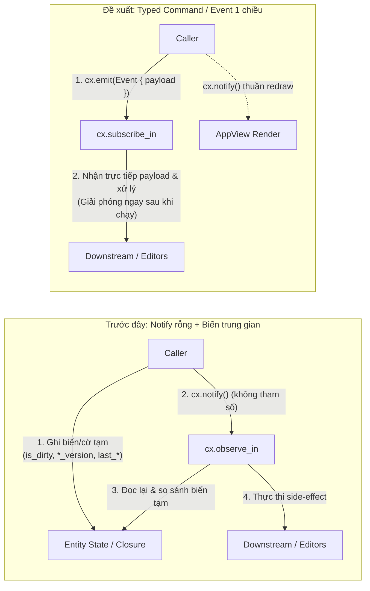

# Kiến trúc Command / Event đồng bộ cho các State Entities

## Goal

Loại bỏ hoàn toàn cơ chế **"phát `cx.notify()` rỗng + ghi dữ liệu/cờ tạm vào biến độc lập để chờ observer đọc lại"** trên toàn bộ `crates/app`.

Thay vào đó, tách biệt rõ 2 kênh trong GPUI:
1. **`cx.notify()` + `cx.observe`**: Chỉ dùng thuần tuý để báo GPUI vẽ lại (`cx.notify()`), **không đọc lại state, không lưu biến tạm để diff, không chạy side-effect**.
2. **`cx.emit(Command/Event)` + `cx.subscribe_in`**: Mọi tác vụ liên-state hoặc đồng bộ xuống Input/Editor đều truyền payload trực tiếp qua sự kiện có kiểu (`WorkspaceEvent`, `SessionEvent`, `ResponseEvent`, `EnvironmentEvent`). Payload được truyền ngay trong 1 lần gọi và **tự động giải phóng bộ nhớ ngay khi handler kết thúc**.



---

## Toàn bộ các vị trí đang mắc Anti-Pattern này và rủi ro thực tế

| Vị trí | Biến trung gian đang lưu | Rủi ro / Lỗi thực tế phát sinh |
| :--- | :--- | :--- |
| **`RequestSessionState` → Auto-save** (`request_session_state.rs`, `subscriptions.rs`) | `ed.is_dirty: bool` | **1. Mất dữ liệu (Race condition)**: `mark_dirty()` chỉ gọi `notify()` khi `!self.is_dirty`. Khi người dùng gõ tiếp trong lúc `is_dirty == true` (đang chờ 500ms debounce hoặc đang ghi đĩa ở background task), `mark_dirty()` không phát sự kiện mới. Khi task ghi đĩa cũ hoàn tất và gán `ed.is_dirty = false` (`persistence_state.rs:190`), thay đổi mới bị nuốt mất.<br/>**2. Lưu thừa**: Khi `is_dirty == true`, mọi thao tác gọi `cx.notify()` trên session (như đổi tab `Headers`/`Params`, mở dropdown) đều khiến observer tưởng nhầm và kích hoạt lại auto-save. |
| **`RequestSessionState` → `ComposerInputs`** (`request_session_state.rs`, `composer_inputs.rs`) | `ed.request_version: usize`<br/>`ed.body_version: usize`<br/>`last_synced_request_id: Option<String>`<br/>`last_synced_request_version: usize`<br/>`last_synced_body_version: usize` | **1. Lệch dữ liệu khi reload từ đĩa**: Khi `PersistenceState` reload file (`resolve_conflict_reload` / watcher), chỉ `ws.notify()` được gọi mà không tăng `ed.request_version`. `ComposerInputs` kiểm tra thấy version không đổi nên bỏ qua, giữ nguyên text cũ trên UI.<br/>**2. Rò rỉ bộ nhớ tạm**: `last_synced_request_id` giữ bản clone `String` suốt vòng đời app. |
| **`RequestSessionState` → Đổi Request** (`subscriptions.rs` L377) | Biến closure `last_req_id: Option<String>` | Mỗi lần `editor_state` notify (gõ phím, đóng/mở menu, đổi tab), observer đều phải đọc `active_request_id`, clone và so sánh với `last_req_id` giữ cố định trong bộ nhớ closure. |
| **`WorkspaceDataState` → Mở Workspace** (`subscriptions.rs` L425) | Biến closure `last_workspace_path: PathBuf` | **1. Lỗi logic nghiêm trọng**: Khi mở workspace mới, observer chỉ cập nhật `git`, `session`, `response` mà **quên gọi `persistence.set_workspace()` và `env.set_workspace()`**, khiến file watcher và môi trường vẫn trỏ vào workspace cũ. Nếu mở lại/import trùng đường dẫn cũ, điều kiện `!= last_workspace_path` sai nên không cập nhật gì cả.<br/>**2. Chi phí thừa**: Mỗi lần workspace notify (pin, đổi tên, tạo request) đều phải clone `PathBuf` để so sánh. |
| **`ResponseState` → `InspectorDisplays`** (`response_state.rs`, `inspector_displays.rs`, `subscriptions.rs` L481) | `last_synced_response_id: Option<String>`<br/>`last_synced_response_view_mode`<br/>`last_synced_example_name: Option<String>` | Mỗi lần `ResponseState` notify (kể cả khi chỉ bật/tắt timing popover, gõ tìm kiếm, lọc console log, đổi tab), observer đều gọi `sync_response_editor` và `sync_sent_request_preview`. Riêng `sync_sent_request_preview` không có biến chặn nên **parse và format lại JSON của request gửi đi ở mọi lần notify**; còn `InspectorDisplays` thì giữ các `String` ID/name trong bộ nhớ. |
| **`EnvironmentState` → Đổi Active Env** (`subscriptions.rs` L503) | Biến closure `last_env_id: Option<String>` | Mọi lần sửa biến môi trường đều gọi `env.notify()`, buộc observer phải đọc và so sánh `active_environment_id` với biến closure `last_env_id`. |

---

## User Review Required

> [!IMPORTANT]
> **Nguyên tắc kiến trúc mới cho `subscriptions.rs`:**
> - **Mọi `cx.observe(...)`** chỉ làm đúng 1 việc: `|_, _, cx| cx.notify()` để vẽ lại UI.
> - **Mọi xử lý nghiệp vụ / đồng bộ dữ liệu** đều đi qua `cx.subscribe_in(...)` với 4 enum sự kiện chuẩn: `WorkspaceEvent`, `SessionEvent`, `ResponseEvent`, `EnvironmentEvent`.
> - Xoá bỏ hoàn toàn các trường `is_dirty`, `request_version`, `body_version` trên `RequestSessionState`, và xoá toàn bộ 6 trường `last_synced_*` trên `ComposerInputs` & `InspectorDisplays`.

---

## Proposed Changes

### 1. Hệ thống hoá các Event / Command trong `crates/app/src/state/`

#### [MODIFY] [workspace_events.rs](file:///Users/dungmv/Documents/macos-native-apps/zest/crates/app/src/state/workspace_events.rs)
Mở rộng và chuẩn hoá hệ thống sự kiện của các State Entities:

```rust
/// Events emitted by `WorkspaceDataState`.
#[derive(Clone)]
pub enum WorkspaceEvent {
    /// A workspace directory was opened or initialized.
    WorkspaceOpened {
        path: PathBuf,
        workspace_name: String,
        store: Arc<dyn WorkspaceStore>,
    },
    /// Request/folder ids changed on disk (rename/move). `(old_id, new_id)` pairs.
    IdsRemapped(Vec<(String, String)>),
    /// Request items were reloaded from disk (e.g. external fs watcher, conflict reload, git discard).
    RequestsReloaded {
        /// `None` means the entire tree was reloaded; `Some(ids)` lists specific request IDs.
        req_ids: Option<Vec<String>>,
    },
    /// A saved example of `req_id` was renamed.
    ExampleRenamed {
        req_id: String,
        old_name: String,
        new_name: String,
    },
    /// A user-initiated CRUD operation was rejected; surfaced as an error toast.
    CrudFailed {
        title: &'static str,
        message: String,
    },
}

/// Scope of composer text inputs to synchronize from the active request model.
#[derive(Debug, Clone, Copy, PartialEq, Eq)]
pub enum ComposerSyncScope {
    /// Only reload body editors (JSON, XML, Raw).
    BodyOnly,
    /// Reload URL, Auth, Pre-request/Test scripts, and Body editors.
    All,
}

/// Events emitted by `RequestSessionState`.
#[derive(Debug, Clone, PartialEq, Eq)]
pub enum SessionEvent {
    /// User switched the active request pointer.
    ActiveRequestChanged { req_id: String },
    /// Active request was mutated and requires debounced auto-save.
    /// Optionally synchronizes composer input editors if the mutation happened outside the input.
    RequestModified {
        req_id: String,
        sync_inputs: Option<ComposerSyncScope>,
    },
    /// Explicitly synchronize composer inputs from the in-memory request model without marking dirty.
    SyncComposerInputs { scope: ComposerSyncScope },
}

/// Events emitted by `ResponseState`.
#[derive(Debug, Clone, Copy, PartialEq, Eq)]
pub enum ResponseEvent {
    /// Displayed response content or view mode changed; inspector editors must update.
    ContentChanged {
        /// `true` when the response/example record itself changed; `false` when only view mode changed.
        sync_sent_preview: bool,
    },
}

/// Events emitted by `EnvironmentState`.
#[derive(Debug, Clone, PartialEq, Eq)]
pub enum EnvironmentEvent {
    /// Active environment selection changed.
    ActiveEnvironmentChanged(Option<String>),
}
```

Implement `EventEmitter<SessionEvent> for RequestSessionState`, `EventEmitter<ResponseEvent> for ResponseState`, và `EventEmitter<EnvironmentEvent> for EnvironmentState`.

---

### 2. Refactor các State Producers

#### [MODIFY] [request_session_state.rs](file:///Users/dungmv/Documents/macos-native-apps/zest/crates/app/src/state/request_session_state.rs)
- **Xoá 3 trường**: `pub is_dirty: bool`, `pub body_version: usize`, `pub request_version: usize`.
- `set_active_request_id(&mut self, req_id: &str, cx: &mut Context<Self>)`:
  - Cập nhật `self.active_request_id = Some(req_id.to_string())`.
  - Phát `cx.emit(SessionEvent::ActiveRequestChanged { req_id: req_id.to_string() })`.
  - Gọi `cx.notify()`.
- `mark_dirty(&mut self, cx: &mut Context<Self>)`:
  - Không còn chặn bởi `if !self.is_dirty` (nhờ vậy mọi lần chỉnh sửa đều reset debounce timer chuẩn xác).
  - Phát `cx.emit(SessionEvent::RequestModified { req_id: self.active_request_id().to_string(), sync_inputs: None })`.
  - Gọi `cx.notify()`.
- Thay `bump_body_version(cx)` bằng `notify_body_changed(cx)`:
  - Phát `cx.emit(SessionEvent::RequestModified { req_id: self.active_request_id().to_string(), sync_inputs: Some(ComposerSyncScope::BodyOnly) })`.
  - Gọi `cx.notify()`.
- Thay `bump_request_version(cx)` bằng `sync_composer_inputs(scope: ComposerSyncScope, cx)`:
  - Phát `cx.emit(SessionEvent::SyncComposerInputs { scope })`.
  - Gọi `cx.notify()`.

#### [MODIFY] [workspace_data_state.rs](file:///Users/dungmv/Documents/macos-native-apps/zest/crates/app/src/state/workspace_data_state.rs)
- Trong `open_workspace`:
  - Phát `cx.emit(WorkspaceEvent::WorkspaceOpened { path, workspace_name, store })` trước `cx.notify()`.
- Trong `execute_import_current_workspace`:
  - Phát `cx.emit(WorkspaceEvent::RequestsReloaded { req_ids: None })` trước `cx.notify()`.

#### [MODIFY] [persistence_state.rs](file:///Users/dungmv/Documents/macos-native-apps/zest/crates/app/src/state/persistence_state.rs)
- Trong `schedule_save_active_request`:
  - Xoá tham số `editor: Entity<RequestSessionState>` không còn cần thiết (vì không còn ghi ngược `ed.is_dirty = false` khi background save xong — `unsaved_requests` trong `PersistenceState` đã là nguồn sự thật duy nhất).
- Trong `handle_fs_events_batch` và `resolve_conflict_reload`:
  - Khi reload cây hoặc reload các file request từ đĩa vào `workspace_data`, phát `cx.emit(WorkspaceEvent::RequestsReloaded { ... })` để nếu request đang mở nằm trong số đó, `ComposerInputs` sẽ tự động cập nhật ngay lập tức.

#### [MODIFY] [response_state.rs](file:///Users/dungmv/Documents/macos-native-apps/zest/crates/app/src/state/response_state.rs)
- Phát `cx.emit(ResponseEvent::ContentChanged { sync_sent_preview: true })` trong:
  - `load_for_request`
  - `start_sending`
  - `set_response_for_request`
  - `set_response`
  - `view_example`
  - `restore_live_response`
- Phát `cx.emit(ResponseEvent::ContentChanged { sync_sent_preview: false })` trong:
  - `set_view_mode`
- Các hàm chỉ đổi trạng thái UI phụ (`set_active_tab`, `toggle_examples_dropdown`, `toggle_timing_popover`, `toggle_wrap_lines`, `set_search_query`, `toggle_search`, `set_console_filter`, `clear_console_logs`, `set_pre_request_logs`, `set_test_results`, `rename_example`) chỉ gọi `cx.notify()`, không phát `ContentChanged`.

#### [MODIFY] [environment_state.rs](file:///Users/dungmv/Documents/macos-native-apps/zest/crates/app/src/state/environment_state.rs)
- Phát `cx.emit(EnvironmentEvent::ActiveEnvironmentChanged(self.active_environment_id.clone()))` trong:
  - `set_active_environment`
  - `rename_environment` (khi `active_environment_id` trùng với env vừa đổi tên)
  - `delete_environment` (đã gọi qua `set_active_environment`).

---

### 3. Refactor `ComposerInputs`, `InspectorDisplays` và Event Handlers

#### [MODIFY] [composer_inputs.rs](file:///Users/dungmv/Documents/macos-native-apps/zest/crates/app/src/app/composer_inputs.rs)
- **Xoá 3 trường**:
  - `pub last_synced_request_id: Option<String>`
  - `pub last_synced_request_version: usize`
  - `pub last_synced_body_version: usize`
- Thay `sync_active_request_editors` (vốn tự đọc version và đoán xem cái gì đổi) bằng hàm nhận trực tiếp `ComposerSyncScope`:
  ```rust
  pub fn sync_inputs(
      &mut self,
      req_id: &str,
      scope: ComposerSyncScope,
      workspace_state: &Entity<WorkspaceDataState>,
      env_state: &Entity<EnvironmentState>,
      window: &mut Window,
      cx: &mut App,
  )
  ```
  - Khi `scope == ComposerSyncScope::All`: đồng bộ URL, Auth, Scripts, và Body cho `req_id`.
  - Khi `scope == ComposerSyncScope::BodyOnly`: chỉ đồng bộ Body cho `req_id`.

#### [MODIFY] [inspector_displays.rs](file:///Users/dungmv/Documents/macos-native-apps/zest/crates/app/src/app/inspector_displays.rs)
- **Xoá 3 trường**:
  - `pub last_synced_response_id: Option<String>`
  - `pub last_synced_response_view_mode: Option<ResponseViewMode>`
  - `pub last_synced_example_name: Option<String>`
- `sync_response_editor` cập nhật thẳng dữ liệu từ `ResponseState` vào `response_editor` vì nó chỉ được gọi đúng khi có sự kiện `ResponseEvent::ContentChanged`.

#### [MODIFY] [workspace_event_handler.rs](file:///Users/dungmv/Documents/macos-native-apps/zest/crates/app/src/app/workspace_event_handler.rs)
Tập trung toàn bộ các hàm xử lý sự kiện liên-state tại đây:
- `handle_workspace_event(this, event, window, cx)`:
  - `WorkspaceOpened { path, workspace_name, store }`:
    1. `persistence.set_workspace(store.clone(), path.clone(), cx)` + `persistence.start_watcher(workspace, env, cx)`
    2. Đọc `active_env` và `active_request` từ `persistence.local_state` mới.
    3. `env.set_workspace(store.clone(), workspace_name, active_env)`
    4. `git.set_repo_path(path, cx)`
    5. `session.set_active_request_id(&next_id, cx)` (tự động phát `SessionEvent::ActiveRequestChanged` để sync `ComposerInputs` và `ResponseState`).
  - `IdsRemapped(pairs)`: remap response cache, session pointer, persistence dirty map.
  - `RequestsReloaded { req_ids }`: nếu active request nằm trong `req_ids` (hoặc `req_ids.is_none()`), gọi `this.composer_inputs.sync_inputs(&active_id, ComposerSyncScope::All, ...)`.
  - `ExampleRenamed`: cập nhật `ResponseState`.
  - `CrudFailed`: đẩy toast lỗi.
- `handle_session_event(this, event, window, cx)`:
  - `ActiveRequestChanged { req_id }`:
    1. `this.composer_inputs.sync_inputs(req_id, ComposerSyncScope::All, ...)`
    2. `persistence.set_active_request(persisted_id, cx)`
    3. `response.load_for_request(req_id, store, cx)`
  - `RequestModified { req_id, sync_inputs }`:
    1. Nếu `let Some(scope) = sync_inputs`, gọi `this.composer_inputs.sync_inputs(req_id, scope, ...)`.
    2. Nếu `req_id != "scratch"`, gọi `persistence.schedule_save_active_request(req_id.clone(), workspace, cx)`.
  - `SyncComposerInputs { scope }`:
    1. Gọi `this.composer_inputs.sync_inputs(&active_id, scope, ...)`.
- `handle_response_event(this, event, window, cx)`:
  - `ContentChanged { sync_sent_preview }`:
    1. `this.inspector_displays.sync_response_editor(&this.state.response, window, cx)`
    2. Nếu `sync_sent_preview`, gọi `this.inspector_displays.sync_sent_request_preview(&this.state.response, window, cx)`.
- `handle_environment_event(this, event, cx)`:
  - `ActiveEnvironmentChanged(env_id)`:
    1. `this.state.persistence.update(cx, |per, cx| per.set_active_environment(env_id.clone(), cx))`.

#### [MODIFY] [subscriptions.rs](file:///Users/dungmv/Documents/macos-native-apps/zest/crates/app/src/app/subscriptions.rs) & [sync.rs](file:///Users/dungmv/Documents/macos-native-apps/zest/crates/app/src/app/sync.rs)
- Trong các `InputEvent::Change` của `url_input`, `bearer_token_input`, `basic_user_input`, `basic_pass_input`, `apikey_key_input`, `apikey_val_input`:
  - Thay vì gán `ed.is_dirty = true` + gọi `save_active_request_without_redraw`, thống nhất gọi `ed.mark_dirty(cx)` (hoặc phát `SessionEvent::RequestModified`).
- Xoá hàm `save_active_request_without_redraw` và file `crates/app/src/app/sync.rs` (hoặc giữ lại nếu còn hàm khác, hiện tại file `sync.rs` chỉ có 18 dòng chứa duy nhất hàm này).
- Trong `subscriptions.rs`:
  - Xoá toàn bộ các biến closure `last_req_id`, `last_workspace_path`, `last_env_id`.
  - Đăng ký 4 `cx.subscribe_in` cho `workspace_state`, `editor_state`, `response_state`, `env_state`.
  - Tất cả các `cx.observe` còn lại chỉ thuần tuý gọi `cx.notify()`.

---

## Verification Plan

### Automated Tests
1. Thêm unit tests trong `crates/app/src/state/workspace_events.rs`:
   - `test_session_events_on_switch_and_modify`: Kiểm tra `set_active_request_id` phát `SessionEvent::ActiveRequestChanged`, và nhiều lần gọi `mark_dirty` liên tiếp đều phát `SessionEvent::RequestModified` (không bị chặn bởi cờ `is_dirty` cũ).
   - `test_workspace_opened_emits_event`: Kiểm tra `open_workspace` phát `WorkspaceEvent::WorkspaceOpened`.
   - `test_environment_active_change_emits_event`: Kiểm tra `set_active_environment` và `rename_environment` phát `EnvironmentEvent::ActiveEnvironmentChanged`.
   - `test_response_content_changed_emits_only_on_content_or_view_mode`: Kiểm tra `set_response` / `set_view_mode` phát `ResponseEvent::ContentChanged`, còn `set_active_tab` / `toggle_timing_popover` không phát event thừa.
2. Chạy toàn bộ pipeline kiểm tra:
```bash
cargo fmt --check
cargo test
cargo clippy --all-targets -- -D warnings
```
