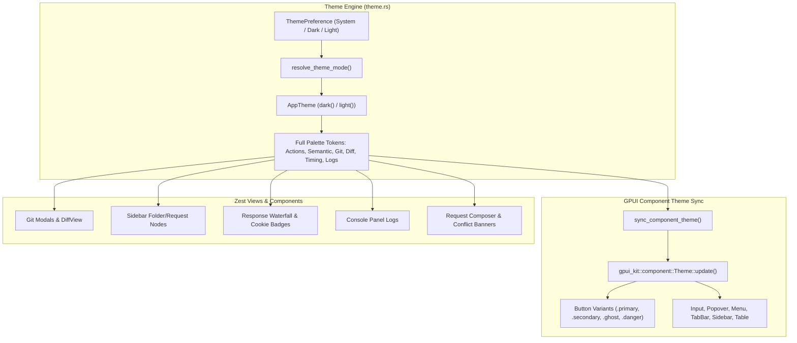

# Implementation Plan: Centralized Theme Color Synchronization

## 1. Goal Description

Currently, button colors, background colors, text colors, and UI indicators across the application are not centrally and synchronously managed through the theme system. This manifests in several concrete issues:

1. **Disconnect between `AppTheme` and `gpui_kit::component::Theme`**: In `crates/app/src/theme.rs`, `sync_component_theme` only synchronizes `popover` and `popover_foreground`. All other components from `gpui-kit` (including `Button` variants, `Input`, `TabBar`, `Tab`, `Sidebar`, `Table`, `DropdownMenu`) fall back to shadcn's default neutral colors (black/white neutrals) rather than Zest's blue/slate brand palette.
2. **Hardcoded Colors across Components**: Multiple UI modules bypass `theme()` and use hardcoded `hex_to_hsla(...)` or `gpui_kit::rgb(...)` values:
   - Git status pills & node colors (`components/git/common.rs`, `commit_modal.rs`, `sidebar/folder_node.rs`, `sidebar/request_node.rs`).
   - Diff view highlights (`components/git/diff_view.rs`).
   - Response waterfall timing bars and security badges (`components/response_inspector.rs`).
   - Script console log sources and levels (`components/console_panel.rs`).
   - Environment autocomplete chips (`components/env_autocomplete/`).
3. **Contrast Deficiencies in Light Mode**: Neon colors designed for dark backgrounds (such as `#4ade80` bright green, `#facc15` bright yellow) are hardcoded and reused in Light Mode, causing near-zero contrast and legibility issues on light backgrounds.
4. **Ad-hoc Button Styling & Workarounds**: Because `gpui-kit`'s default `Button` colors did not match Zest's palette, developers resorted to manual style overrides (e.g. `.ghost().bg(t.bg_card).border_1().border_color(t.border)`) or raw `div()` buttons with custom `on_click` handlers and inconsistent hover states (e.g., conflict banners in `request_composer.rs`).

The goal of this initiative is to centralize all color tokens into `AppTheme`, comprehensively synchronize `AppTheme` with `gpui_kit::component::Theme`, eliminate all scattered hardcoded colors, and standardize button styling across the entire workspace.

---

## 2. User Review Required

> [!IMPORTANT]
> **Component Visual Consistency**: All `gpui-kit` buttons (`.primary()`, `.secondary()`, `.ghost()`, `.danger()`) and form controls will now automatically reflect Zest's Slate + Blue theme in both Dark and Light modes.
> Modal action buttons that previously rendered with dark-gray/black backgrounds in light mode will now render with vibrant primary blue (`#2563eb`) in light mode and (`#3b82f6`) in dark mode, matching the design specifications.

> [!NOTE]
> **Accessibility in Light Mode**: Git status indicators (Added, Modified) and Diff lines in Light Mode will now use dedicated high-contrast light-mode colors (e.g., deep emerald `#059669` instead of unreadable neon green `#4ade80`, warm amber `#d97706` instead of neon yellow `#facc15`), while retaining vibrant colors in Dark Mode.

---

## 3. Open Questions

None currently blocking. The proposed design follows the existing Slate + Blue color hierarchy established in `crates/app/src/theme.rs` and complies with GPUI architecture guidelines.

---

## 4. Proposed Changes



---

### Component 1: `crates/app/src/theme.rs` — Palette Expansion & Full Sync

#### [MODIFY] `crates/app/src/theme.rs`
1. Expand `AppTheme` struct with missing semantic and component color tokens:
   - **Button / Action Variants**:
     - `primary_active`: `Hsla`
     - `secondary`: `Hsla`
     - `secondary_hover`: `Hsla`
     - `secondary_active`: `Hsla`
     - `secondary_foreground`: `Hsla`
     - `danger`: `Hsla`
     - `danger_hover`: `Hsla`
     - `danger_active`: `Hsla`
     - `danger_foreground`: `Hsla`
     - `warning`: `Hsla`
     - `warning_hover`: `Hsla`
     - `warning_foreground`: `Hsla`
     - `success`: `Hsla`
     - `success_hover`: `Hsla`
     - `success_foreground`: `Hsla`
     - `info`: `Hsla`
     - `info_hover`: `Hsla`
     - `info_foreground`: `Hsla`
   - **Git Status Tokens**:
     - `git_added`: `Hsla`
     - `git_modified`: `Hsla`
     - `git_deleted`: `Hsla`
     - `git_untracked`: `Hsla`
     - `git_ignored`: `Hsla`
   - **Diff Tokens**:
     - `diff_added_bg`: `Hsla`
     - `diff_added_text`: `Hsla`
     - `diff_deleted_bg`: `Hsla`
     - `diff_deleted_text`: `Hsla`
   - **Timing Waterfall Tokens**:
     - `timing_dns`: `Hsla`
     - `timing_tcp`: `Hsla`
     - `timing_tls`: `Hsla`
     - `timing_ttfb`: `Hsla`
     - `timing_download`: `Hsla`
   - **Console / Log Tokens**:
     - `log_info`: `Hsla`
     - `log_warn`: `Hsla`
     - `log_error`: `Hsla`
     - `log_pre_request`: `Hsla`
     - `log_post_response`: `Hsla`
   - **Autocomplete Variable Type Tokens**:
     - `tag_variable`: `Hsla`
     - `tag_dynamic`: `Hsla`
2. Populate `AppTheme::dark()` and `AppTheme::light()` with tuned, contrast-safe values.
3. Update `sync_component_theme(mode: ThemeMode, cx: &mut App)`:
   - Call `gpui_kit::component::Theme::update(cx, |ct| { ... })` and synchronize all 50+ properties of `ThemeColor`:
     - `background`, `foreground`, `border`, `input`, `ring`, `popover`, `popover_foreground`
     - `primary`, `primary_hover`, `primary_active`, `primary_foreground`
     - `button_primary`, `button_primary_hover`, `button_primary_active`, `button_primary_foreground`
     - `secondary`, `secondary_hover`, `secondary_active`, `secondary_foreground`
     - `button_secondary`, `button_secondary_hover`, `button_secondary_active`, `button_secondary_foreground`
     - `danger`, `danger_hover`, `danger_active`, `danger_foreground`
     - `button_danger`, `button_danger_hover`, `button_danger_active`, `button_danger_foreground`
     - `warning`, `warning_foreground`, `button_warning`, `button_warning_hover`
     - `success`, `success_foreground`, `button_success`, `button_success_hover`
     - `button`, `button_hover`, `button_active`, `button_foreground`
     - `accent`, `accent_foreground` (tied to `t.bg_hover` and `t.text_primary`)
     - `muted`, `muted_foreground`
     - `sidebar`, `sidebar_border`, `sidebar_foreground`, `sidebar_accent`, `sidebar_accent_foreground`
     - `title_bar`, `title_bar_border`
     - `tab_bar`, `tab`, `tab_active`, `tab_active_foreground`, `tab_foreground`
     - `table`, `table_head`, `table_head_foreground`, `table_hover`, `table_active`, `table_row_border`

---

### Component 2: Eliminate Hardcoded Git & Diff Colors

#### [MODIFY] `crates/app/src/components/git/common.rs`
- Replace hardcoded `gpui_kit::rgb(...)` in `git_status_color` with `t.git_modified`, `t.git_added`, `t.git_deleted`, `t.text_muted`.

#### [MODIFY] `crates/app/src/components/git/commit_modal.rs`
- Replace hardcoded untracked label color with `t.git_untracked`.

#### [MODIFY] `crates/app/src/components/git/diff_view.rs`
- In `render_diff_content`, replace hardcoded `green_bg`, `green_text`, `red_bg`, `red_text` with:
  - `t.diff_added_bg`, `t.diff_added_text`, `t.diff_deleted_bg`, `t.diff_deleted_text`.

#### [MODIFY] `crates/app/src/components/sidebar/folder_node.rs` and `crates/app/src/components/sidebar/request_node.rs`
- Replace `let git_green = gpui_kit::rgb(0x4ade80)` and `let git_yellow = gpui_kit::rgb(0xfacc15)` with `t.git_added` and `t.git_modified`.

---

### Component 3: Eliminate Hardcoded Colors in Inspector, Console & Autocomplete

#### [MODIFY] `crates/app/src/components/response_inspector.rs`
- Replace hardcoded waterfall bar colors (`0x06b6d4`, `0x3b82f6`, `0xa855f7`, `0xeab308`, `0x22c55e`) with `t.timing_dns`, `t.timing_tcp`, `t.timing_tls`, `t.timing_ttfb`, `t.timing_download`.
- Replace hardcoded cookie badge colors with `t.success` and `t.primary`.

#### [MODIFY] `crates/app/src/components/console_panel.rs`
- Replace hardcoded hex colors with `t.log_pre_request`, `t.log_post_response`, `t.log_info`, `t.log_warn`, `t.log_error`.

#### [MODIFY] `crates/app/src/components/env_autocomplete/render.rs` and `mod.rs`
- Replace `const TYPE_VARIABLE_COLOR` and `const TYPE_DYNAMIC_COLOR` with `t.tag_variable` and `t.tag_dynamic`.

---

### Component 4: Standardize Buttons & Clean Up Workarounds

#### [MODIFY] `crates/app/src/app/request_composer.rs`
- Convert conflict banner buttons (`#btn-conflict-reload`, `#btn-conflict-keep`) from custom raw `div()` into standard `Button::new("btn-conflict-reload").primary().small()` and `Button::new("btn-conflict-keep").secondary().small()`.

#### [MODIFY] `crates/app/src/app/auth_tab.rs`
- Clean up `btn-auth-type-dropdown` and `btn-auth-apikey-location-dropdown`: simplify to use proper `Button::secondary()` styling instead of `.ghost().bg(t.bg_card).border_1().border_color(t.border)`.

#### [MODIFY] `crates/app/src/components/settings_modal/general_tab.rs` & `network_tab.rs`
- Standardize dropdown buttons with `.secondary().compact()` rather than manual border/background overrides.

---

## 5. Verification Plan

### Automated Tests
1. **Unit tests in `crates/app/src/theme.rs`**:
   - Verify dark and light themes provide distinct non-empty values for all new semantic tokens.
   - Verify `sync_component_theme` updates `gpui_kit::component::Theme` properly.
   - Run tests:
     ```bash
     cargo test --bin zest
     ```
2. **Clippy strict check**:
   ```bash
   cargo clippy --all-targets -- -D warnings
   ```
3. **Workspace Full Test Suite**:
   ```bash
   cargo test
   ```

### Manual Verification
1. **Theme Mode Switching**:
   - Open Settings Modal -> General Tab.
   - Toggle between **Dark**, **Light**, and **System**.
   - Verify all buttons (Primary buttons in Commit/Branch/Import modals, Secondary buttons, Ghost buttons) adapt immediately without leftover black/white shadcn styling.
2. **Light Mode Legibility**:
   - In Light mode, inspect Git status pills in the sidebar and Git modals. Confirm Added/Modified items are clearly legible with deep contrast.
   - Open Git Diff view. Verify green/red background highlights and diff text are comfortable and readable.
3. **Response Inspector & Console**:
   - Send a request and inspect the Response Inspector: check waterfall timing bars and cookie badges in both Dark and Light modes.
   - Open Console panel: verify log tags (`INFO`, `WARN`, `Pre-request`, `Post-response`) adapt cleanly to both themes.
