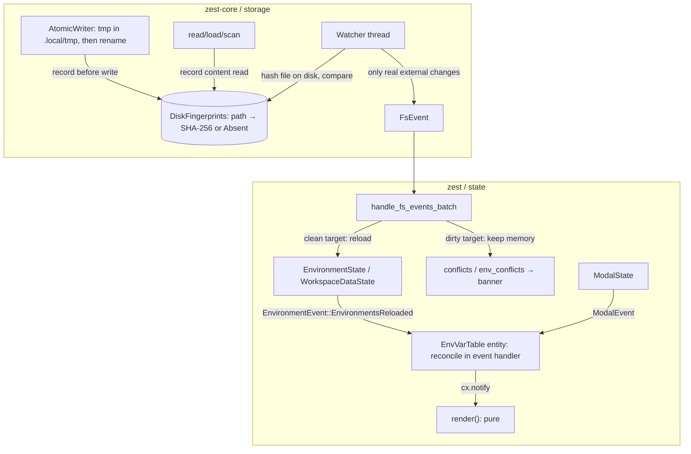

# Fix: Watcher self-echo corrupts env modal input (complete fix, no leftover debt)

## Goal

Typing fast in the Environment modal (type → delete → type again) reverts or corrupts the text. The plan fixes the **root cause** and the **whole class of related bugs** in the sync path from disk → memory → input, following the model used by VS Code and Zed:

1. **Recognize self-writes by content**, not by a time window.
2. **Never overwrite in-memory content that has unsaved edits** when reloading from disk. Raise a conflict instead.
3. **Pure render**: input sync goes through the event channel, not through `render()`.

## Background: root causes found

| # | Problem | Location | Effect |
|---|---|---|---|
| R1 | Temp file `environments/.tmp_<uuid>_dev.yaml` isn't suppressed and still ends in `.yaml`, so the watcher treats it as `EnvironmentChanged` | [`serialize.rs`](file:///Users/dungmv/Documents/macos-native-apps/zest/crates/core/src/storage/serialize.rs#L45-L71), [`watcher.rs`](file:///Users/dungmv/Documents/macos-native-apps/zest/crates/core/src/storage/watcher.rs#L165-L181) | App reloads every env from disk ~300ms after each save → **the typing bug** |
| R2 | Same thing for `collections/.tmp_<uuid>_req.yaml` | watcher | Fake `RequestChanged(".tmp_…")`: phantom `parse_errors` entry or an unnecessary `reload_tree()` |
| R3 | `save_workspace_meta` and `save_folder_meta` (+ `fs_ops` writing `_folder.yaml`) **don't call `suppress_path`** | [`fs_store.rs`](file:///Users/dungmv/Documents/macos-native-apps/zest/crates/core/src/storage/fs_store.rs#L365-L499) | Echo `TreeChanged` → `reload_tree()` |
| R4 | Suppression is **time-based (1500ms)** | `FsWorkspaceStore::new` (`workspace-suppress-cleaner`) | Fragile: late FSEvents delivery leaks through; also hides real external changes inside the window |
| R5 | Env reload **doesn't check pending/in-flight writes** | [`persistence_state.rs`](file:///Users/dungmv/Documents/macos-native-apps/zest/crates/app/src/state/persistence_state.rs#L568-L573) | Unsaved edits get overwritten |
| R6 | `reload_tree()` **replaces every request**, including dirty ones | [`workspace_data_state.rs`](file:///Users/dungmv/Documents/macos-native-apps/zest/crates/app/src/state/workspace_data_state.rs#L249) | Any `TreeChanged` (R2/R3 or a real one) can wipe what you're typing in the request composer |
| R7 | `EnvVarTableState::reconcile()` runs **inside `render()`** and calls `set_value` | [`env_modal.rs`](file:///Users/dungmv/Documents/macos-native-apps/zest/crates/app/src/components/env_modal.rs#L730-L737) | Violates AGENTS.md §2.3; it's the channel that pushes stale data into the input |
| R8 | `env_modal.rs` is 946 LOC | — | Violates the ~650 LOC rule (§3.4) |
| R9 | Dead code `save_environments*` / `flush_environments` / `env_save_task` also reload from disk after writing | [`environment_state.rs`](file:///Users/dungmv/Documents/macos-native-apps/zest/crates/app/src/state/environment_state.rs#L419-L465) | Latent risk of the same race |

## Target architecture



---

## Phase A: zest-core storage (R1–R4)

### [NEW] `crates/core/src/storage/fingerprints.rs`

Registry of the **last disk content the app knows about** for each path, like VS Code's etag or Zed's `saved_mtime`:

```rust
#[derive(Debug, Clone, Copy, PartialEq, Eq)]
pub enum Fingerprint {
    Content([u8; 32]), // SHA-256 (sha2 is already a dependency)
    Absent,
}

#[derive(Default)]
pub struct DiskFingerprints {
    map: Mutex<HashMap<String, Fingerprint>>, // key = normalize_path_key(path)
}

impl DiskFingerprints {
    pub fn record_content(&self, path: &Path, bytes: &[u8]);
    pub fn record_absent(&self, path: &Path);
    pub fn forget(&self, path: &Path);
    /// True when the current on-disk state equals the last known state,
    /// i.e. the event is an echo of our own write/read and can be ignored.
    /// `Absent` entries are consumed once confirmed, to keep the map bounded.
    pub fn matches_disk(&self, path: &Path) -> bool;
}
```

- `normalize_path_key` reuses the existing logic from `watcher.rs` (`strip_unc_str`, `/private` prefix, lowercase, `/`→`\`) moved into this module, so watcher and store share one implementation.
- Locks use `unwrap_or_else(|p| p.into_inner())` (§3.2).
- Map size is bounded by the number of files in the workspace. `Absent` entries are removed once the watcher confirms them.

### [MODIFY] [serialize.rs](file:///Users/dungmv/Documents/macos-native-apps/zest/crates/core/src/storage/serialize.rs)

Replace the free function `atomic_write` / `atomic_write_str` with an `AtomicWriter`:

```rust
pub struct AtomicWriter {
    tmp_dir: PathBuf,                    // <workspace>/.local/tmp
    fingerprints: Arc<DiskFingerprints>,
}

impl AtomicWriter {
    /// Records the fingerprint BEFORE touching disk so the watcher can never
    /// observe the new content without a matching fingerprint.
    pub fn write_str(&self, path: &Path, content: &str) -> io::Result<()>;
    pub fn remove_file(&self, path: &Path) -> io::Result<()>;          // record_absent + remove
    pub fn rename(&self, from: &Path, to: &Path) -> io::Result<()>;    // absent(from) + content(to)
}
```

- **Temp file goes into `.local/tmp/`** (already ignored by the watcher via `.local`, and on the same volume so the rename stays atomic).
- **Fallback**: if the rename fails with `EXDEV` (e.g. `.local` is a symlink to another volume), use a sibling temp file `.tmp_<uuid>_<name>` in the target directory. The watcher ignores it because of the dot-prefix rule below.
- On `FsWorkspaceStore::new`, delete leftover `.tmp_*` files in `.local/tmp` from a previous crash.
- Windows keeps writing directly (sharing-violation constraint). The fingerprint is still recorded before the write, and the watcher's 200ms debounce means it reads only after the write has finished.

### [MODIFY] [fs_store.rs](file:///Users/dungmv/Documents/macos-native-apps/zest/crates/core/src/storage/fs_store.rs) and [fs_ops.rs](file:///Users/dungmv/Documents/macos-native-apps/zest/crates/core/src/storage/fs_ops.rs)

- **Remove** `suppressed_paths`, `suppress_tx`, `suppress_path()`, and the `workspace-suppress-cleaner` thread.
- `FsWorkspaceStore` owns `Arc<DiskFingerprints>` + `AtomicWriter`. The `fs_ops` functions take `&AtomicWriter` instead of calling `atomic_write_str` / `std::fs::rename` / `remove_file` directly.
- **Every** write into the watched tree goes through the writer:
  - `write_request`, `create_request`, `delete_request`, `rename_request`, `move_request`
  - `save_environment` / `delete_environment` / `rename_environment` (globals goes through `save_environment("globals")`)
  - `save_workspace_meta`, `save_folder_meta`, `create_group`, `rename_group`, `move_group`, `reorder_folder` (`_folder.yaml`). Fixes **R3**.
- **Reads record the content they read**: `read_request`, `load_environment`, `load_workspace_meta`, `load_folder_meta`, `scan_tree`. The fingerprint therefore always reflects the disk version currently in memory. If a later external change happens to revert the file to an older version, it's still detected correctly.
- Directory renames/moves (`rename_group`, `move_group`) still produce a `TreeChanged` from directory events. The app is already reloading the tree after these structural actions, and with Phase B (dirty preservation) that reload is idempotent and safe.

### [MODIFY] [traits.rs](file:///Users/dungmv/Documents/macos-native-apps/zest/crates/core/src/storage/traits.rs#L92-L95)

```diff
-    /// Thread-safe set of paths currently suppressed from watcher notifications
-    fn suppressed_paths(&self) -> Arc<Mutex<HashSet<PathBuf>>>;
+    /// Last known on-disk fingerprints, used by the watcher to drop self-echo events.
+    fn disk_fingerprints(&self) -> Arc<DiskFingerprints>;
```

### [MODIFY] [watcher.rs](file:///Users/dungmv/Documents/macos-native-apps/zest/crates/core/src/storage/watcher.rs)

- Signature: `start_workspace_watcher(root, fingerprints: Arc<DiskFingerprints>, tx)`.
- Ignore paths whose **file name starts with `.`** (`is_hidden_artifact`): temp files, editor swap files, `.DS_Store`. Fixes **R1/R2** even when the EXDEV fallback is used.
- For file events (`environments/*.yaml`, `collections/**/*.yaml`, `workspace.yaml`): if `fingerprints.matches_disk(path)` → **drop** (self-echo). Otherwise emit the event. Directory events and `.git` handling are unchanged. Fixes **R4**.
- `downgrade_existing_deletions` stays.

---

## Phase B: app persistence, dirty-aware reload (R5, R6)

### [MODIFY] [persistence_state.rs](file:///Users/dungmv/Documents/macos-native-apps/zest/crates/app/src/state/persistence_state.rs)

- `start_watcher` uses `self.store.disk_fingerprints()`.
- Add `pub env_conflicts: HashMap<String, String>` (key = env name or `"globals"`), cleared in `set_workspace`.
- `handle_fs_events_batch`:
  - Collect `changed_envs: HashSet<String>` from `EnvironmentChanged(stem)` instead of a single `env_changed` bool.
  - Collect dirty env targets from `coordinator.dirty_targets()` (`Environment(name)` / `Globals`).
  - Call `env.apply_disk_changes(&changed_envs, &dirty)` → returns the list of envs that are dirty **and** changed on disk → put them in `env_conflicts` with the message *"Environment file was modified externally while you have unsaved changes."*
  - `TreeChanged` → `ws.reload_tree_preserving(&dirty_request_ids)`, where `dirty_request_ids` = `unsaved_requests` ∪ `coordinator` dirty `Request(..)` targets.
- New methods mirroring the request equivalents:
  - `resolve_env_conflict_reload(name, env_state, cx)`: cancel the target, reload that env from disk, clear the conflict.
  - `resolve_env_conflict_keep(name, env_state, cx)`: enqueue a write with debounce 0 from the memory copy, clear the conflict.

### [MODIFY] [environment_state.rs](file:///Users/dungmv/Documents/macos-native-apps/zest/crates/app/src/state/environment_state.rs)

```rust
/// Applies on-disk changes reported by the watcher. Environments with unsaved
/// edits keep their in-memory copy; those also changed on disk are returned
/// as conflicts. Emits `EnvironmentEvent::EnvironmentsReloaded`.
pub fn apply_disk_changes(
    &mut self,
    changed: &HashSet<String>,
    dirty: &HashSet<String>,       // env names, "globals" for globals
    cx: &mut Context<Self>,
) -> Vec<String>;

/// Reloads a single environment (or "globals") from disk. Used by conflict "Reload".
pub fn reload_environment_from_disk(&mut self, name: &str, cx: &mut Context<Self>);
```

- `apply_disk_changes` lists env names again (to handle envs added or deleted externally). A clean env is loaded from disk. A dirty env keeps its memory copy, including when its file was deleted (that also counts as a conflict).
- `reload_environments()` stays a private helper (used by `new`, `set_workspace`, create/duplicate/rename/delete). Those public paths emit `EnvironmentsReloaded` after reloading.
- **Remove dead code (R9)**: `save_environments`, `save_environments_debounced`, `flush_environments`, the `env_save_task` field, and `save_global_environment_silently` / `save_global_environment` if a grep confirms they have no callers.

### [MODIFY] [workspace_data_state.rs](file:///Users/dungmv/Documents/macos-native-apps/zest/crates/app/src/state/workspace_data_state.rs)

```rust
/// Rescans the tree but keeps the in-memory `HttpRequestItem` for every request
/// that still has unsaved edits (folder placement taken from the scan).
/// Requests whose file disappeared are dropped (deletion wins, consistent with
/// the existing RequestDeleted handling).
pub fn reload_tree_preserving(&mut self, dirty: &HashSet<String>);
```

`reload_tree()` becomes `reload_tree_preserving(&HashSet::new())`, so existing callers behave the same.

### [MODIFY] [workspace_events.rs](file:///Users/dungmv/Documents/macos-native-apps/zest/crates/app/src/state/workspace_events.rs)

```diff
 pub enum EnvironmentEvent {
     ActiveEnvironmentChanged(Option<String>),
     EnvironmentModified(String),
     GlobalsModified,
+    /// Environments were (re)loaded from disk; UI inputs must re-sync.
+    EnvironmentsReloaded,
 }
+
+/// Events emitted by `ModalState`.
+pub enum ModalEvent {
+    /// Env modal opened or a different environment was selected in it.
+    EnvModalSelectionChanged,
+}
+impl EventEmitter<ModalEvent> for ModalState {}
```

- `handle_environment_event` ignores `EnvironmentsReloaded`, so it doesn't trigger a save.
- `ModalState::open_env_modal*` / `select_modal_environment` emit `ModalEvent::EnvModalSelectionChanged`.

---

## Phase C: env modal, pure render + modularization (R7, R8)

### [DELETE] `components/env_modal.rs` → [NEW] folder `components/env_modal/`

| File | Contents | Estimated LOC |
|---|---|---|
| `mod.rs` | `EnvironmentModal` (RenderOnce shell): `ModalDialog` + layout, reads state, **no mutations** | ~150 |
| `env_list.rs` | Left sidebar: Globals item, env list, context menu (rename/duplicate/delete), inline rename | ~300 |
| `detail_header.rs` | Detail header + "+ Add Variable" + **env conflict banner** (Reload / Keep mine) | ~180 |
| `var_table.rs` | `EnvVarTable` entity: row `InputState`s, subscriptions, reconcile, `Render` impl for the table | ~400 |

### `EnvVarTable` entity

- Created **once** in `AppView::new` (with `window`), stored as a field next to `ComposerInputs` / `InspectorDisplays`, and passed to `EnvironmentModal::new(..)`. This replaces `window.use_keyed_state` inside render.
- Fields: `env_state`, `modal_state`, `bound_env_id: String`, `rows: Vec<EnvVarRowInputs>`, `_subscriptions`.
- Sync **only through events** (`cx.subscribe_in(.., window, ..)`):
  - `ModalEvent::EnvModalSelectionChanged` → if the env id changed: **rebuild** the rows (clear + create), so row subscriptions always point at the right env.
  - `EnvironmentEvent::EnvironmentsReloaded` → `reconcile()` (only `set_value` when values differ).
  - `EnvironmentModified` / `GlobalsModified` for the bound env → `reconcile_structure()`: only adds/removes rows when the count changes (add/delete variable), never `set_value` on existing rows, so it can't fight the user's typing.
- `Render for EnvVarTable` only builds elements from `rows` + `env_state.read(cx)`: **0 mutations** (§2.3).
- Row secret toggle / delete keep their current logic, moved into `var_table.rs`.

### [MODIFY] [modals.rs](file:///Users/dungmv/Documents/macos-native-apps/zest/crates/app/src/app/modals.rs), [app/mod.rs](file:///Users/dungmv/Documents/macos-native-apps/zest/crates/app/src/app/mod.rs)

Add `env_var_table: Entity<EnvVarTable>` to `AppView` and to `ModalOverlayEntities`, plus `persistence_state` for the conflict banner. The modal receives only the entities it needs (no `AppState` prop-drilling).

---

## Phase D: docs and rules

- [MODIFY] `.agents/skills/local-first-storage-vcs/SKILL.md`: replace the `suppress_path` section with `DiskFingerprints` + `AtomicWriter` + the dirty-aware reload rules.
- [MODIFY] `docs/technical-debt.md`: add an entry (resolved) describing R1–R9 and the fix, for history.
- [MODIFY] `AGENTS.md` §2.6: replace the sentence *"register paths with `FsWorkspaceStore::suppress_path` (managed by the `workspace-suppress-cleaner` thread)"* with *"go through `AtomicWriter`, which records `DiskFingerprints` before writing; the watcher drops events whose on-disk content matches the known fingerprint, and reloads never overwrite targets with pending writes (conflicts are surfaced instead)"*.
- Sync this plan to `docs/plans/2026110302-env-modal-typing-race-fix.md`.

## User Review Required

> [!IMPORTANT]
> **Changing `AGENTS.md` §2.6**: this is the rule file that governs agents. The current wording (`suppress_path`) will be wrong after this change, so it has to be updated. Please confirm you're OK with editing it.

> [!WARNING]
> **Breaking change for the `WorkspaceStore` trait**: `suppressed_paths()` → `disk_fingerprints()`. Every implementation and test mock must be updated (I'll grep and fix all of them in the same change).

> [!NOTE]
> **Behavior change**: external changes to an env while you have unsaved edits now show a **conflict banner** (Reload / Keep mine), the same way requests already work, instead of silently overwriting. Directory renames still reload the tree, but dirty requests are always preserved.

## Implementation order and commits

1. Phase A (core) + core tests → `cargo test -p zest-core`.
2. Phase B (state) + state tests.
3. Phase C (UI refactor).
4. Phase D (docs) → full verification pipeline.

Each phase is one commit, to make review and bisecting easier.

## Verification Plan

### Automated tests

**zest-core**
- `fingerprints.rs`: record_content → `matches_disk` true; change file content → false; `record_absent` + file removed → true, and the entry is consumed after confirmation; path normalization (`/private/var` vs `/var`, case).
- `AtomicWriter`: temp file is created in `.local/tmp` and the target directory never contains `.tmp_*`; the leftover-cleanup on init removes old temp files.
- `watcher.rs` integration:
  - `store.save_environment("dev", ..)` → **no** `EnvironmentChanged` is received within 1s.
  - External `std::fs::write(environments/dev.yaml, other content)` → `EnvironmentChanged("dev")` is received.
  - Writing `environments/.tmp_x_dev.yaml` / `.DS_Store` → no event.
  - `save_workspace_meta` / `save_folder_meta` → no `TreeChanged`.
- Replace `test_suppress_path_worker_lifecycle` with the tests above.

**zest (app)**
- `environment_state`: `apply_disk_changes` keeps a dirty env (memory `"typing"`, disk `"disk"`) and returns a conflict; a clean env takes the disk value; an env added or deleted externally updates the list; `EnvironmentsReloaded` is emitted.
- `persistence_state` (TestAppContext): simulated `FsEvent::EnvironmentChanged` while the env target is pending → memory unchanged and `env_conflicts` contains the env; resolve keep/reload behave correctly.
- `workspace_data_state`: `reload_tree_preserving` keeps the dirty request and takes the clean one from disk.
- `EnvVarTable`: changing the selection rebuilds the rows; `EnvironmentsReloaded` with a new value → input updated; `EnvironmentModified` (user typing) → no `set_value` on existing rows.

**Pipeline**
```bash
cargo fmt --check
cargo test
cargo clippy --all-targets -- -D warnings
```
Plus: `wc -l` on every file in `components/env_modal/` is < 650.

### Manual verification
1. Env modal: type fast, pause ~0.5s, Backspace, keep typing, repeated many times → text never reverts; the YAML ends up with the final value.
2. Same thing in the request composer (URL/body) while renaming a folder in the sidebar → content isn't lost.
3. Modal idle, edit `environments/<env>.yaml` externally → modal updates immediately.
4. While typing (unsaved), edit the same env file externally → conflict banner appears; "Keep mine" writes the memory version, "Reload" takes the disk version.
5. Check that `environments/` and `collections/` never show `.tmp_*` files (`git status` stays clean).
